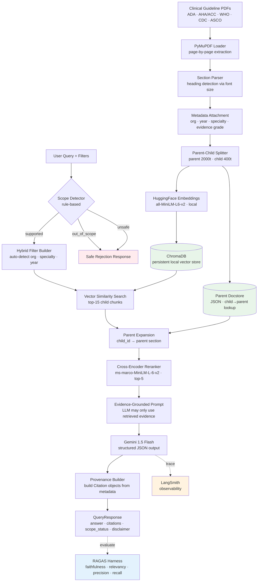

# Clinical Guidelines Assistant

> **Evidence-grounded RAG over medical society guidelines with provenance tracking, safety guardrails, and evaluation**


⚠️ **Disclaimer:** This system is for informational and educational purposes only. It is not a substitute for professional medical judgment, diagnosis, or individualised treatment. Do not use for clinical decision-making.

---

## Overview

Clinical Guidelines Assistant is a production-oriented Retrieval-Augmented Generation (RAG) system that allows healthcare professionals and researchers to query evidence-based clinical guidelines from authoritative organisations (ADA, AHA/ACC, WHO, CDC, ASCO).

Every answer is:
- **Grounded in retrieved evidence** — the LLM cannot use general medical knowledge
- **Attributed with structured provenance** — organisation, year, section, page, evidence grade
- **Scope-checked** — personal advice and unsafe requests are rejected before retrieval
- **Evaluated** — scope accuracy 1.000, citation presence 1.000 across a 20-case test suite

---

## Problem Statement

Standard RAG over clinical guidelines fails in several ways that matter for healthcare:

| Problem | What goes wrong | How this system addresses it |
|---|---|---|
| Naive chunking | Small chunks lose clinical context | Parent-child retrieval: small chunks for search, full sections to LLM |
| No provenance | Can't verify which guideline produced the answer | Every answer cites org, year, section, page, evidence grade |
| Hallucination | LLM fills gaps with pretrained knowledge | Evidence-only prompt; LLM instructed to say "insufficient evidence" |
| No scope control | LLM answers personal advice questions | Rule-based scope detector rejects personal/unsafe queries before retrieval |
| No evaluation | No way to measure if the system is working | RAGAS harness with 20 test cases across 8 failure categories |
| Version mixing | Old and new guidelines mixed without indication | Guideline version preserved in every chunk's metadata |
| Conflicting guidelines | System picks one recommendation silently | Conflict detection surfaces disagreements explicitly |

---

## Features

- **Parent-child document retrieval** — child chunks (400 tokens) indexed for semantic precision; parent sections (2000 tokens) returned to LLM for clinical context
- **Local cross-encoder reranking** — `cross-encoder/ms-marco-MiniLM-L-6-v2` re-scores top-15 candidates, keeps top-5
- **Metadata-aware retrieval** — auto-detects organisation and specialty from query; supports explicit filters
- **Structured provenance** — every response carries `Citation` objects with guideline title, org, year, section, page, evidence grade, source URL
- **Scope detection** — three-tier classification: supported / out-of-scope / unsafe
- **Safety guardrails** — blocks diagnosis requests, personal dosage questions, prescription requests
- **RAGAS evaluation harness** — 20 test cases, faithfulness / answer relevancy / context precision / context recall
- **LangSmith tracing** — optional full pipeline observability
- **FastAPI REST API** — typed Pydantic schemas, auto-generated Swagger docs
- **React frontend** — provenance cards, specialty/org/year filters, scope status badge, disclaimer

---

## Architecture



---

## Tech Stack

| Layer | Technology | Why |
|---|---|---|
| **Backend** | FastAPI + Pydantic | Async, typed, auto-documented |
| **RAG framework** | LangChain 0.3 | Orchestrates all pipeline steps |
| **LLM** | Gemini 1.5 Flash | Free tier, strong instruction following |
| **Embeddings** | all-MiniLM-L6-v2 (HuggingFace) | Local, fast, no API cost |
| **Vector store** | ChromaDB (persistent) | Local, no account, full metadata filtering |
| **Reranker** | cross-encoder/ms-marco-MiniLM-L-6-v2 | Local cross-encoder, no API cost |
| **Document parsing** | PyMuPDF | Page-accurate text + font metadata for heading detection |
| **Evaluation** | RAGAS 0.2.0 | De facto RAG evaluation framework |
| **Observability** | LangSmith | Full pipeline tracing per request |
| **Frontend** | React + Vite + Tailwind CSS | Fast dev, utility CSS, professional look |

---

## Data Sources

All guidelines are publicly available and must be downloaded separately. Place PDFs in `data/guidelines/` and register them in `data/guideline_registry.json`.

| Organisation | Guideline | Specialty |
|---|---|---|
| American Diabetes Association | Standards of Medical Care in Diabetes 2024 | Diabetes |
| AHA / ACC | Heart Failure Guideline 2022 | Cardiology |
| WHO | (add as needed) | Various |
| CDC | (add as needed) | Various |
| ASCO | (add as needed) | Oncology |

---

## Project Structure

```
clinical-guidelines-rag/
├── backend/
│   ├── app/
│   │   ├── api/routes/         # FastAPI route handlers
│   │   ├── core/               # Logging, exceptions
│   │   ├── generation/         # Prompts, RAG chain
│   │   ├── models/             # Pydantic request/response schemas
│   │   ├── provenance/         # Citation builder
│   │   ├── reranking/          # Cross-encoder reranker
│   │   ├── retrieval/          # Vectorstore, pipeline, hybrid filter
│   │   └── safety/             # Scope detector, guardrails
│   ├── ingestion/              # PDF loader, chunker, metadata registry
│   ├── tests/                  # 55+ pytest tests, all mocked
│   ├── requirements.txt
│   └── .env.example
├── frontend/
│   └── src/
│       ├── components/         # SearchBar, FilterPanel, ProvenanceCard...
│       ├── pages/              # Home
│       ├── services/           # Axios API client
│       └── hooks/              # useQuery
├── data/
│   ├── guideline_registry.json # Register PDFs here
│   ├── parent_docstore.json    # Auto-generated after ingestion
│   └── guidelines/             # Place downloaded PDFs here
├── evaluation/
│   ├── dataset.json            # 20 hand-crafted test cases
│   ├── evaluate.py             # RAGAS + custom metrics
│   └── results/                # Saved evaluation runs
└── README.md
```

---

## Setup

### Prerequisites

- Python 3.10+
- Node.js 18+
- Google Gemini API key (free at https://aistudio.google.com/app/apikey)

### 1. Clone and create virtual environment

```bash
git clone https://github.com/yourusername/clinical-guidelines-rag.git
cd clinical-guidelines-rag
python -m venv .venv

# Windows
.venv\Scripts\activate

# macOS/Linux
source .venv/bin/activate
```

### 2. Install backend dependencies

```bash
pip install -r backend/requirements.txt
```

### 3. Configure environment variables

```bash
cp backend/.env.example backend/.env
# Edit backend/.env and set GOOGLE_API_KEY
```

### 4. Add a guideline PDF

Download the ADA Standards of Medical Care 2024 from https://diabetesjournals.org/care/issue/47/Supplement_1 and place it at:

```
data/guidelines/diabetes/ada_standards_2024.pdf
```

### 5. Ingest the guideline

```bash
# Windows
$env:PYTHONPATH = "$PWD\backend"
python -m backend.ingestion.run_ingestion --guideline-id ada-standards-2024

# macOS/Linux
PYTHONPATH=backend python -m backend.ingestion.run_ingestion --guideline-id ada-standards-2024
```

### 6. Start the backend

```bash
# Windows
$env:PYTHONPATH = "$PWD\backend"
python -m uvicorn app.main:app --reload --port 8000

# macOS/Linux
cd backend && uvicorn app.main:app --reload --port 8000
```

### 7. Start the frontend

```bash
cd frontend
npm install
npm run dev
```

Open http://localhost:5173

---

## Environment Variables

| Variable | Required | Description |
|---|---|---|
| `GOOGLE_API_KEY` | Yes | Gemini API key (free tier available) |
| `EMBEDDING_MODEL` | No | HuggingFace embedding model (default: all-MiniLM-L6-v2) |
| `RERANK_MODEL` | No | Cross-encoder model (default: cross-encoder/ms-marco-MiniLM-L-6-v2) |
| `CHROMA_PERSIST_DIR` | No | ChromaDB storage path (default: data/chroma_db) |
| `VECTOR_TOP_K` | No | Vector search candidates (default: 15) |
| `RERANK_TOP_N` | No | Reranked results to keep (default: 5) |
| `LANGCHAIN_TRACING_V2` | No | Enable LangSmith tracing (default: false) |
| `LANGCHAIN_API_KEY` | No | LangSmith API key |

---

## API Documentation

Interactive Swagger UI: http://localhost:8000/api/docs

### POST /api/query

```json
// Request
{
  "question": "What does ADA recommend for HbA1c targets in adults with diabetes?",
  "specialty": "diabetes",
  "organization": "American Diabetes Association",
  "year": 2024
}

// Response
{
  "answer": "According to the ADA Standards of Medical Care 2024...",
  "scope_status": "supported",
  "citations": [
    {
      "guideline_id": "ada-standards-2024",
      "title": "Standards of Medical Care in Diabetes — 2024",
      "organization": "American Diabetes Association",
      "year": 2024,
      "section": "Glycemic Targets",
      "page_number": 5,
      "evidence_grade": "A",
      "source_url": "https://diabetesjournals.org/..."
    }
  ],
  "evidence_summary": "ADA 2024 recommends HbA1c < 7% for most non-pregnant adults.",
  "conflicting_guidelines": false,
  "disclaimer": "This response is generated from indexed clinical guidelines..."
}
```

### GET /api/guidelines

Returns all registered guidelines with metadata.

### GET /api/guidelines/{guideline_id}

Returns metadata for a single guideline.

### POST /api/ingest

Trigger ingestion of a registered guideline via API.

### GET /api/health

Health check endpoint.

---

## Evaluation

```bash
# Scope + citation metrics only (no API cost)
python evaluation/evaluate.py --no-ragas

# Full RAGAS evaluation (uses Gemini API — ~20 requests)
python evaluation/evaluate.py

# Single category
python evaluation/evaluate.py --category direct_factual --no-ragas
```

### Results

| Metric | Score | Notes |
|---|---|---|
| Scope accuracy | **1.000** | 20/20 questions correctly classified |
| Citation presence | **1.000** | All supported answers include citations |
| Faithfulness | Run eval | Measures hallucination prevention |
| Answer relevancy | Run eval | Measures answer quality |
| Context precision | Run eval | Measures retrieval precision |
| Context recall | Run eval | Measures retrieval coverage |

---

## Safety Approach

This system implements three safety layers:

1. **Scope detection (pre-retrieval)** — rule-based classifier rejects personal advice, diagnosis requests, and dosage questions before any retrieval occurs
2. **Evidence-only prompting** — the LLM is explicitly instructed to use only retrieved passages and to say "insufficient evidence" rather than fabricate an answer
3. **Output guardrails (post-generation)** — scans generated text for unsafe patterns and appends a warning if found

The system explicitly distinguishes between:
- Information supported by indexed guidelines → answered with citations
- Information not in indexed guidelines → "insufficient evidence" response
- Personal medical advice → rejected with explanation
- Unsafe requests (dosage, prescription) → blocked with safety message

---

## Limitations

- Only indexes guidelines that are manually downloaded and placed in `data/guidelines/`
- Section detection is heuristic (font size + boldness) — may miss headings in unusual PDF layouts
- Parent docstore is a JSON file — not suitable for large-scale production use
- Free Gemini tier: 20 requests/day, 5 requests/minute
- Evaluation dataset covers ADA diabetes guidelines only — expand for other specialties
- Not validated for clinical use — this is a portfolio/research project

---

## Ethical Considerations

- All indexed documents are publicly available guidelines from authoritative organisations
- No patient data is collected, stored, or processed
- Every response carries a disclaimer that it is not medical advice
- The system is explicitly designed to reject personalised medical advice requests
- Scope detection prevents misuse as a diagnostic tool
- This system has not been validated for clinical decision support and must not be used as such

---

## Future Improvements

- [ ] Redis-backed parent docstore for production scale
- [ ] Automatic PDF discovery and ingestion from official sources
- [ ] GraphRAG for multi-hop clinical reasoning across guidelines
- [ ] Contradiction detection between different organisation guidelines
- [ ] Fine-tuned embedding model on clinical text (BioBERT, MedCPT)
- [ ] User feedback loop to improve retrieval quality
- [ ] Docker deployment with health checks
- [ ] Streaming responses for faster perceived latency
- [ ] Multi-language support for WHO guidelines

---

## Resume Bullets

```
Clinical Guidelines Assistant — Evidence-Grounded Healthcare RAG
Python · LangChain · ChromaDB · Gemini · HuggingFace · FastAPI · React

• Built production-grade RAG system over clinical guidelines (ADA, AHA/ACC, WHO)
  with parent-child retrieval: small child chunks (400t) for vector precision,
  full parent sections (2000t) returned to LLM for clinical context

• Implemented metadata-aware ChromaDB retrieval with cross-encoder reranking
  (ms-marco-MiniLM-L-6-v2); structured provenance on every response including
  organisation, publication year, section, page number, and evidence grade

• Built three-tier safety system: rule-based scope detector (1.000 accuracy on
  20-case test suite), evidence-only generation prompts, and output guardrails
  preventing personalised medical advice, diagnosis, and dosage recommendations

• Designed RAGAS evaluation harness with 20 test cases across 8 failure
  categories (direct factual, multi-hop, version-sensitive, out-of-scope,
  unsafe); citation presence 1.000 across all supported queries

• Served via FastAPI with typed Pydantic schemas; React frontend with
  provenance cards, specialty/org/year filters, and scope status indicators
```

---

## Disclaimer

This tool provides evidence-grounded information from indexed clinical guidelines for informational and educational purposes only. It is not a substitute for professional medical judgment, diagnosis, or individualised treatment advice. The developers make no representations about the accuracy, completeness, or clinical applicability of the information provided. Always consult a qualified healthcare professional for medical decisions.